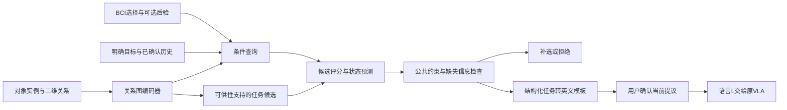

场景与BCI上下文意图模块设计（v0.1）

日期：2026年10月15日。当前阶段：模块设计与原型代码；按最新要求，训练、实际LLM比较和机器人实验暂不开展。

**模块的职责与边界**

模块接收已观测到的对象、关系、BCI选择和用户已经明确提供的任务上下文，预测一个结构化任务，再转成下游VLA可接收的英文指令。它替代现有`infer_intent_with_gemini()`所承担的上游任务解释环节，保留自然语言L接口。

支持的动作集合先限定为`pick`、`place`、`fold`。输出只描述已支持任务，不增加π0.5自身没有的机器人技能，也不提供开放领域常识。动作可供性由调用方的真实任务能力表声明，不能把检测到某对象等同于机器人能够操作它。

如果同一观测对应多个合理的用户意图，模块必须请求补选；不能通过网络高置信度代替用户提供缺失信息。默认没有用户目标，也没有已确认动作时，“看见葡萄和碗、用户选择葡萄”仍可能是拿起、放入等不同意图，不能宣称知道用户想做哪一个。



这里的公共校验负责检查输入是否足够、候选是否合法，不负责把网络预测错误改成正确任务。原始网络输出会被保留。现阶段模块和适配器均不导入机械臂SDK、不发送动作。

**输入规范**

输入为`observation`，只有四个顶层字段：`objects`、`relations`、`selection`、`context`。场景ID、标注和最终结果不进入网络。

| 字段 | 内容 | 获取来源及限制 |
|---|---|---|
| 对象实例 | id、类别、图像归一化xy、属性、可供性、可选检测置信 | Florence/SAM的类别和框可直接适配；ID在同一提议周期必须一致 |
| 对象关系 | subject、predicate、object、confidence | 原型支持左右、上下、near等；适配器只从图像几何推导简单二维关系，不伪造三维或容纳关系 |
| BCI选择 | object_id、可选probabilities | 现有硬选择可直接输入；若有多个同类对象，类别名不能直接选第一个实例 |
| 当前上下文 | goal、confirmed_action、confirmed_destination_id、destination_hint | 来自用户已选择的任务模式或明确补选，不能由真实答案反填 |
| 历史 | 最多8条已确认action/source/destination事件 | 仅使用过去可见记录；`repeat_last`必须是用户明确选择的重复模式 |

`goal`取值：`unspecified`、`pick`、`put_away`、`fold`、`repeat_last`。目的地提示取值：`unspecified`、`leftmost`、`rightmost`、`nearest_source`。这是受限任务输入词表，不是能理解任意语言的编码器。

对象类别及属性通过稳定哈希映射到可学习嵌入；这只避免固定词表查找，不赋予未见词汇的语义知识，且存在哈希碰撞风险。需要开放类别泛化时应另行设计或引入经过验证的语义特征，不能从当前实现推断。

BCI后验是可选输入，不应把原始FBCCA相关系数直接叫作概率。原型对提供的非负权重归一化；真实使用前需要确认它们来自适当的概率估计/校准。缺失后验时保留硬选择，不声称其置信度为100%。

**网络结构与当前默认配置**

1. 对象编码：类别嵌入＋属性嵌入＋xy、检测分数、可供性、选择标记、BCI权重的数值投影，得到每个对象64维表示。
2. 关系编码：2层、4头的关系注意力。谓词边和相对xy/距离同时进入注意力偏置与消息值。对象列表置换时，表示与候选应保持对应，不依赖任意实例ID的字符串拼写。
3. 条件查询：汇总全局场景、BCI加权选中对象、当前目标和历史事件。历史事件引用对象节点，按时间新近程度加权；当前明确目标不会被旧历史覆盖。
4. 候选构造：枚举可供性允许的`(action, source_id, destination_id)`。候选生成不使用BCI选择、当前目标或标签答案，否则去BCI等变体会通过候选列表获得被移除的信息。
5. 联合候选评分：为每个完整三元组打分，而非让三个独立分类头各自输出可能矛盾的动作、源对象和目的地。对象和目的地通过当前实例引用选择。
6. 状态头：预测`ready/clarify/reject`；补选头预测`source/action/destination`。候选头处理任务选择，状态和补选头处理是否需要更多输入。

默认hidden_dim=64、num_layers=2、num_heads=4、dropout=0.1。参数量由训练manifest实测记录，此处不编造大小或速度结果。当前图为小规模全对象注意力，未验证大场景性能；它也不会提高SSVEP物理界面的目标数上限。

设计参考了图注意力用于图结构特征交互的基本思路：[Graph Attention Networks](https://arxiv.org/abs/1710.10903)。这里提出的是针对当前系统的组合与接口设计，GAT本身不是新增贡献。

**输出与语言实现**

成功提议示例：

```json
{
  "status": "ready",
  "intent": {"action": "place", "source_id": "grape_1", "destination_id": "bowl_1"},
  "instruction": "Put the grapes into the bowl.",
  "requires_confirmation": true
}
```

信息不足示例：

```json
{
  "status": "clarify",
  "intent": null,
  "instruction": null,
  "clarification": {"slot": "destination", "options": [{"id": "bowl_1", "label": "bowl"}, {"id": "bowl_2", "label": "bowl"}]},
  "requires_confirmation": false
}
```

模板目前为`Pick up the ...`、`Put the ... into the ...`、`Fold the ...`。同类对象优先使用可唯一指代的属性或leftmost/rightmost描述，不能直接把`object_3`当作VLA可理解的目标。如果无法唯一表述，继续补选或拒绝，不能默选。

这属于受限任务语言实现。自然语言句子通顺不等于意图正确，也不等于VLA一定能落实其中的空间指代。

**训练目标与数据要求（接口已预留，尚未训练）**

标注单位为公开观测及其应有决策：明确的任务三元组，或缺失槽位，或无可支持任务。不能对信息不足的同一输入强行赋唯一的隐藏用户意图作为训练真值。

当前损失：

`L = CE(status) + CE(candidate | gold ready) + 0.25 × CE(slot | gold clarify)`

候选损失仅在真值为ready时计算；补选槽位损失仅在真值为clarify时计算。训练与验证以真实物理场景或更大的近重复采集组划分。训练代码不接收test参数，阈值和温度仅由验证集选择；小验证集上的经验精度不构成部署可靠性保证。

`confidence`是状态分数与候选分数的组合，后续可做验证集校准，不能直接解释为知道用户真实意图的概率。共享BCI缺失信息判断的0.7/0.2规则是当前保守默认参数，需在实际数据上验证，不是论文结果。

**与服务器现有代码的接入位置**

现有：`scripts/inference.py::infer_intent_with_gemini()`返回字符串后，主流程将字符串赋给`TASK_INSTRUCTION`。

建议改为：

```text
视觉服务labels+bboxes + 当前帧尺寸 + 实例ID/能力表
→ observation_from_detections(...)
→ ContextIntentAdapter.propose(...)
→ clarify：BCI补选并构造新observation
→ reject：保持不执行
→ ready：展示完整指令，获得用户对该提议的确认
→ adapter.confirm(proposal_id, confirmed_intent, current_observation)
→ 将返回的语言字符串交给原有VLA接口
```

`integration.py`包含这个适配层。提议ID一次性使用，取消、新提议或输入场景变化会使旧确认失效。原型当前以公开输入摘要严格检查变化；实机连续视觉存在抖动，后续需要验证语义变化判定和实例跟踪，不能把此原型直接当作完整机器人安全系统。

该模块只交付指令，运行中停止通道、相机故障、网络超时、动作缓冲清理和机械臂限位由下游控制系统负责。即使任务提议通过，也不能代替执行安全检查。

**已经完成与尚未完成**

- 已完成：输入验证、关系网络源码、联合候选/状态/补选预测、语言模板、旧视觉输出适配、确认适配器、训练接口和独立模块目录。
- 已做的软件检查：本地单元测试和语法检查；本机缺少PyTorch，神经网络前向/训练相关单元测试标记跳过，不声称已运行通过。
- 未完成且本阶段不开展：真实数据标注、模型训练、神经网络运行性能验证、实际Gemini调用、消融运行、机器人接入与人因实验。
- 服务器原仓库没有被修改。当前原型保存在本地`D:\Scene_Aware\context_intent`，尚无可用于替换Gemini的训练权重。

现有显式目标、提示和可供性在有限任务中可能已足以由规则确定答案。因此本设计首先提供可训练和可检查的接口，尚不能证明网络优于规则；未来若无学习收益，应据实简化系统。此前形成的实验文档和运行入口仅作为待执行草案保留。
